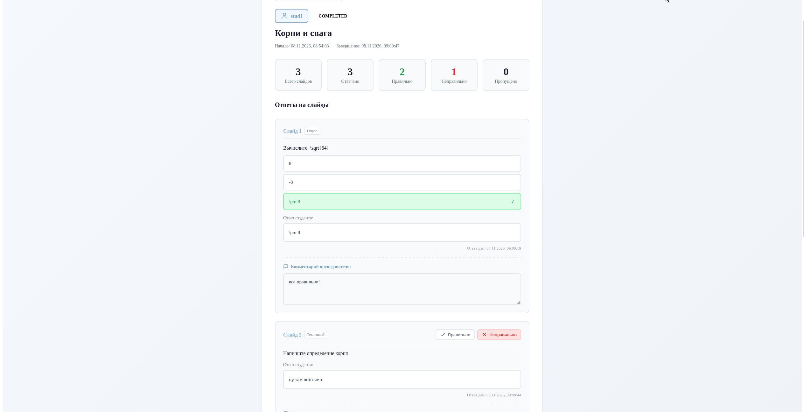
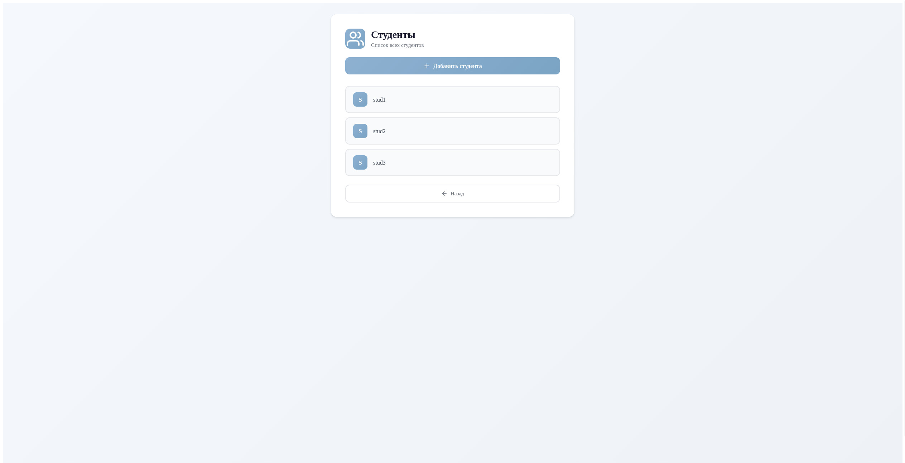
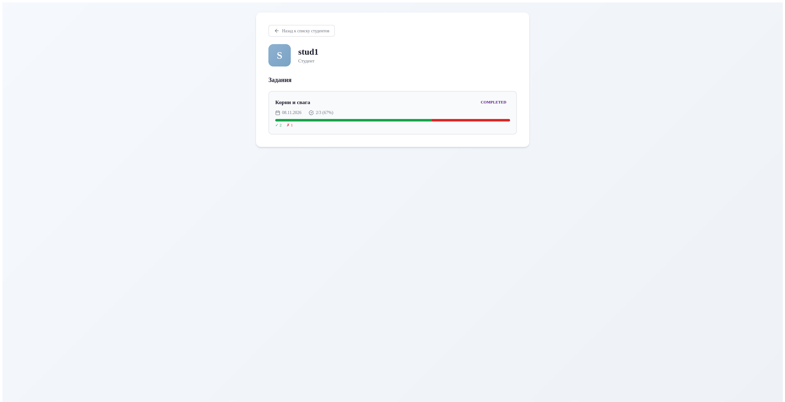

# sctest

Веб-приложение для организации учебного процесса между преподавателями и учениками. Платформа позволяет создавать и выдавать учебные задания, отслеживать их выполнение, проверять ответы и предоставлять обратную связь.

## демо
[открыть приложение](https://sendai-sctest.duckdns.org)

## Возможности

### Кабинет преподавателя

- Управление учениками — создание ученических аккаунтов и просмотр списка учеников.
- Управление заданиями — создание и выдача заданий ученикам.
- Проверка работ — просмотр выполненных заданий и проверка ответов.
- Обратная связь — возможность оставлять комментарии к выполненным заданиям.

### Кабинет ученика

- Выполнение заданий — просмотр назначенных заданий и отправка ответов.
- Отслеживание прогресса — просмотр статусов заданий.
- Результаты проверки — просмотр результатов проверенных работ.
- Обратная связь — чтение комментариев и замечаний преподавателя.

### Типы заданий

- Опрос — задания с выбором ответа.
- Текстовый ответ — задания, предполагающие ввод собственного ответа.

## скриншоты

## Технологический стек

| Технология | Назначение |
|---|---|
| SvelteKit | Frontend |
| Spring Boot | Backend |
| PostgreSQL | База данных |
| Nginx | Reverse proxy |

## Архитектура

Приложение построено по клиент-серверной архитектуре.

- Frontend (SvelteKit) — пользовательский интерфейс и взаимодействие с платформой.
- Backend (Spring Boot) — бизнес-логика, обработка запросов и взаимодействие с базой данных.
- PostgreSQL — хранение данных приложения.
- Nginx — reverse proxy для маршрутизации входящих HTTP-запросов к соответствующим компонентам приложения.

## Статус проекта

Проект находится в стадии разработки. Основной функционал для организации взаимодействия преподавателей и учеников уже реализован.